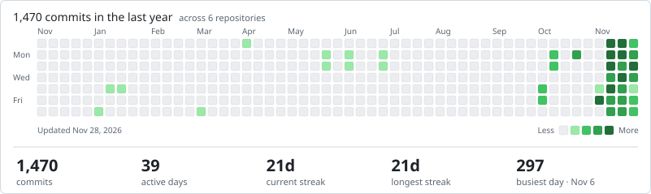

<!-- Public org profile: github.com/ShamyLab. Edit the tagline and sections freely. -->

  

<h1 align="center">ShamyLab</h1>

  A small lab building trading systems, iOS apps and developer tools.

  
  
  

### Activity

<picture>
  <source media="(prefers-color-scheme: dark)" srcset="https://raw.githubusercontent.com/ShamyLab/.github/main/profile/assets/activity-dark.svg">
  <source media="(prefers-color-scheme: light)" srcset="https://raw.githubusercontent.com/ShamyLab/.github/main/profile/assets/activity-light.svg">
  
</picture>

Commits across every ShamyLab repository, public and private. Refreshed every 6 hours.
